# Portfólio - Ian Marques

> [!NOTE]
> Portfólio pessoal bilíngue (PT/EN) em **React + Vite**, feito a partir de um wireframe no Figma, para apresentar quem eu sou, o que já fiz e como me contatar.

<table>
  <tr>
    <td width="800px">
      <div align="justify">
        Meu <b>portfólio profissional</b>, com as seções <i>Sobre mim</i>, <i>Projetos</i>, <i>Experiência</i> e <i>Contato</i>, em <b>português e inglês</b>. Segue o <a href="https://www.figma.com/design/59HE9vWPeXAmnReXJaGGQY/Wireframe-%E2%80%94-Portf%C3%B3lio?node-id=2-142&t=h36nvD972Su7hc3n-1">wireframe do Figma</a> e tem um <b>formulário que envia a mensagem direto para o meu e-mail</b> via EmailJS.
      </div>
    </td>
    <td>
      
    </td>
  </tr>
</table>

---

## Status do Projeto

**Em produção**, hospedado no Render.

[](https://github.com/ianmarques000/portfolio-react)
[](https://portfolio-ianmarques.onrender.com/)
   

---

## Índice
- [Links Úteis](#links-úteis)
- [Sobre o Projeto](#sobre-o-projeto)
- [Funcionalidades Principais](#funcionalidades-principais)
- [Tecnologias Utilizadas](#tecnologias-utilizadas)
- [Arquitetura](#arquitetura)
- [Instalação e Execução](#instalação-e-execução)
- [Deploy](#deploy)
- [Estrutura de Pastas](#estrutura-de-pastas)
- [Demonstração](#demonstração)
- [Testes](#testes)
- [Documentações utilizadas](#documentações-utilizadas)
- [Autor](#autor)
- [Contribuição](#contribuição)
- [Agradecimentos](#agradecimentos)
- [Licença](#licença)

---

## Links Úteis
* **Demo Online:** [portfolio-ianmarques.onrender.com](https://portfolio-ianmarques.onrender.com/)
* **Repositório:** [github.com/ianmarques000/portfolio-react](https://github.com/ianmarques000/portfolio-react)
* **Wireframe:** [Figma — Wireframe Portfólio](https://www.figma.com/design/59HE9vWPeXAmnReXJaGGQY/Wireframe-%E2%80%94-Portf%C3%B3lio?node-id=2-142&t=h36nvD972Su7hc3n-1)

---

## Sobre o Projeto

Sou estudante de Engenharia de Software (PUC Minas) e produtor musical independente em Belo Horizonte. Criei este portfólio para reunir em um só lugar meus projetos, minha experiência e a melhor forma de falar comigo, facilitando o contato de recrutadores, colegas e clientes. Também foi um exercício de transformar um wireframe do Figma em uma página fiel e responsiva usando só React e CSS.

Projetos apresentados: **DEADMXNE** (música), **PORTUGESES** (jogo em Python/Pygame), **WAVEFORGE** (plataforma musical) e **CUIDA+** (gestão de saúde para idosos).

---

## Funcionalidades Principais

- **Português e inglês:** botão de idioma no canto superior; a escolha fica salva no navegador.
- **Menu de navegação:** aparece após a tela inicial, à direita no desktop e embaixo no celular, destacando a seção atual.
- **Linha do tempo** dos projetos.
- **Formulário de contato:** validação, proteção anti-spam e envio por EmailJS.
- **Responsivo e acessível:** layout do wireframe no desktop e coluna única abaixo de 1024px.

---

## Tecnologias Utilizadas

* **Front-end:** React 18, JavaScript (ES6+), CSS puro, Open Sans
* **Build Tool:** Vite 5
* **E-mail:** `@emailjs/browser` 5
* **Cloud:** Render (site estático, configurado em `render.yaml`)
* **Back-end:** não há; o envio do formulário é feito direto pelo EmailJS

---

## Arquitetura

SPA 100% front-end, com uma seção por componente (`Hero`, `About`, `Projects`, `Experience`, `Contact`).

- **Conteúdo separado da interface:** os textos PT/EN ficam em `src/data/`.
- **Idioma:** `LanguageContext` fornece `lang` e `t` para os componentes.
- **Menu:** o hook `useDock` usa `IntersectionObserver`.
- **Layout:** cada seção é um palco 16:9 (base 1920×1080 do Figma), com posições em % e fontes em `cqw`.

---

## Instalação e Execução

**Pré-requisitos:** Node.js 18+ e npm.

```bash
git clone https://github.com/ianmarques000/portfolio-react.git
cd portfolio-react
npm install
cp .env.example .env
npm run dev
```

Abre em http://localhost:5173. Para o build de produção: `npm run build` e `npm run preview`.

### Variáveis de Ambiente

| Variável | Descrição |
| :--- | :--- |
| `VITE_EMAILJS_SERVICE_ID` | ID do serviço de e-mail no EmailJS. |
| `VITE_EMAILJS_TEMPLATE_ID` | ID do template no EmailJS. |
| `VITE_EMAILJS_PUBLIC_KEY` | Chave pública do EmailJS. |

O template do EmailJS deve usar `from_name`, `from_email`, `reply_to` e `message` (o formulário também envia `lang`). Sem as variáveis, o site funciona, mas o formulário avisa que não está configurado.

---

## Deploy

Publicado no **Render** como site estático (`render.yaml`: `npm install && npm run build`, pasta `dist`, Node 20). Cadastre as três variáveis `VITE_EMAILJS_*` no painel do Render.

> As variáveis `VITE_*` são embutidas no build, então mudar o valor exige novo deploy.

---

## Estrutura de Pastas

```
portfolio-react/
├── index.html
├── package.json
├── vite.config.js
├── render.yaml          # Deploy no Render
├── .env.example         # Modelo das variáveis de ambiente
└── src/
    ├── main.jsx
    ├── App.jsx
    ├── assets/          # Imagens e ícones
    ├── components/      # Componentes de cada seção
    ├── css/             # Estilos
    ├── data/            # Textos (PT/EN), projetos, experiências e contatos
    ├── fonts/           # Open Sans
    ├── hooks/           # useDock.js (menu)
    └── i18n/            # Troca de idioma
```

---

## Demonstração

 Veja ao vivo: [portfolio-ianmarques.onrender.com](https://portfolio-ianmarques.onrender.com/)

| Desktop | Mobile |
| :---: | :---: |
| _Adicione o print aqui_ | _Adicione o print aqui_ |

---

## Testes

Ainda não há testes automatizados. A verificação é manual com `npm run build` e `npm run preview`.

---

## Documentações utilizadas

* [React](https://react.dev/reference/react)
* [Vite](https://vitejs.dev/guide/)
* [EmailJS](https://www.emailjs.com/docs/)
* [Render Static Sites](https://render.com/docs/static-sites)
* [Conventional Commits](https://www.conventionalcommits.org/en/v1.0.0/)

---

## Autor

| Nome | Foto | GitHub | LinkedIn | Gmail |
|---------|----------|-----------------|-------------|-----------|
| Ian Poty Arandu de Albuquerque Marques | <div align="center"></div> | <div align="center"><a href="https://github.com/ianmarques000"></a></div> | <div align="center"><a href="https://www.linkedin.com/in/ianpoty/"></a></div> | <div align="center"><a href="mailto:deadmxne@gmail.com"></a></div> |

---

## Contribuição

Projeto pessoal, mas sugestões são bem-vindas: faça um `fork`, crie uma branch, commit com [Conventional Commits](https://www.conventionalcommits.org/en/v1.0.0/) e abra um **Pull Request**.

---

## Agradecimentos

* [**Engenharia de Software PUC Minas**](https://www.instagram.com/engsoftwarepucminas/) - Pelo ambiente acadêmico em que o projeto foi desenvolvido.
* [**Prof. Dr. João Paulo Aramuni**](https://github.com/joaopauloaramuni) - Pelo modelo de README usado como base.

---

## Licença

Este repositório ainda não possui um arquivo de licença definido. Até que um seja adicionado, todos os direitos pertencem ao autor.