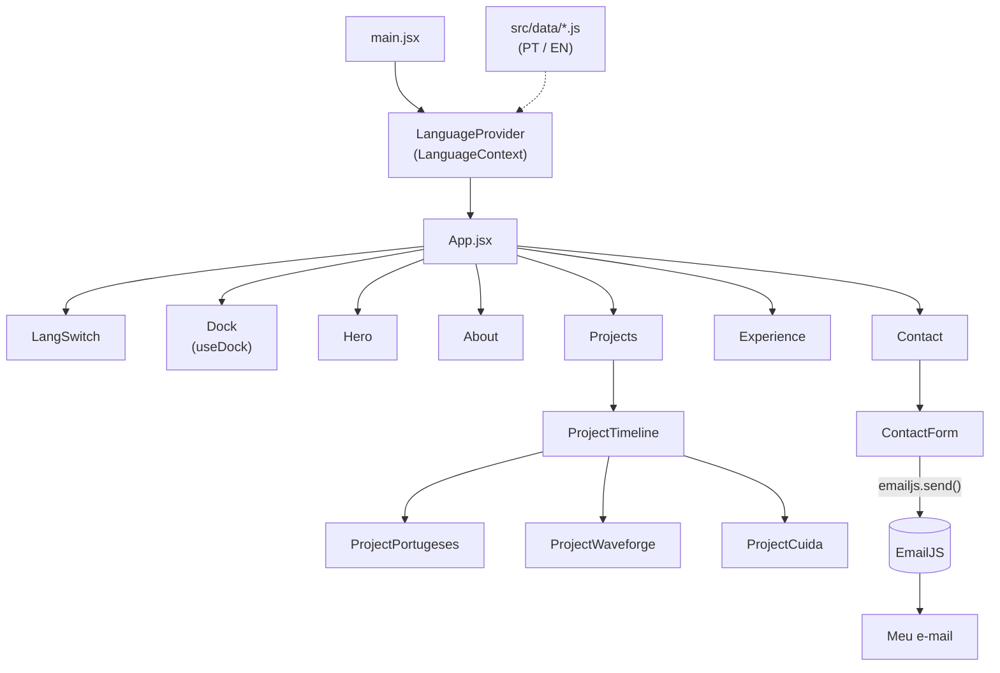

---

# 🎨 Portfólio - Ian Marques 👨‍💻

> [!NOTE]
> Portfólio pessoal bilíngue (PT/EN) em **React + Vite**, construído a partir de um wireframe no Figma, para apresentar quem eu sou, o que já fiz e como entrar em contato comigo.

<table>
  <tr>
    <td width="800px">
      <div align="justify">
        Este é o meu <b>portfólio profissional</b>, desenvolvido em <b>React 18</b> com <b>Vite 5</b> e <b>CSS puro</b> (sem biblioteca de componentes). O site reúne as seções <i>Sobre mim</i>, <i>Projetos</i>, <i>Experiência</i> e <i>Contato</i>, está disponível em <b>português e inglês</b> e segue de perto o <a href="https://www.figma.com/design/59HE9vWPeXAmnReXJaGGQY/Wireframe-%E2%80%94-Portf%C3%B3lio?node-id=2-142&t=h36nvD972Su7hc3n-1">wireframe criado no Figma</a>. Na seção de contato há os links das minhas redes e um <b>formulário que envia a mensagem direto para o meu e-mail</b> via EmailJS.
      </div>
    </td>
    <td>
      <div>
        
      </div>
    </td>
  </tr>
</table>

---

## 🚧 Status do Projeto

**Em produção** · hospedado no Render.

[](https://github.com/ianmarques000/portfolio-react)
[](https://portfolio-ianmarques.onrender.com/)
       

---

## 📚 Índice
- [Links Úteis](#-links-úteis)
- [Sobre o Projeto](#-sobre-o-projeto)
- [Funcionalidades Principais](#-funcionalidades-principais)
- [Tecnologias Utilizadas](#-tecnologias-utilizadas)
- [Arquitetura](#-arquitetura)
  - [Diagrama de componentes](#diagrama-de-componentes)
  - [Layout baseado no wireframe](#layout-baseado-no-wireframe)
  - [Decisões e limitações](#decisões-e-limitações)
- [Instalação e Execução](#-instalação-e-execução)
  - [Pré-requisitos](#pré-requisitos)
  - [Variáveis de Ambiente](#-variáveis-de-ambiente)
  - [Instalação de Dependências](#-instalação-de-dependências)
  - [Como Executar a Aplicação](#-como-executar-a-aplicação)
  - [Configurando o EmailJS](#-configurando-o-emailjs)
- [Deploy](#-deploy)
- [Estrutura de Pastas](#-estrutura-de-pastas)
- [Demonstração](#-demonstração)
- [Testes](#-testes)
- [Documentações utilizadas](#-documentações-utilizadas)
- [Autor](#-autor)
- [Contribuição](#-contribuição)
- [Agradecimentos](#-agradecimentos)
- [Licença](#-licença)

---

## 🔗 Links Úteis
* 🌐 **Demo Online:** [portfolio-ianmarques.onrender.com](https://portfolio-ianmarques.onrender.com/)
  > 💻 **Descrição:** Site em produção, hospedado no Render como site estático.
* 💾 **Repositório:** [github.com/ianmarques000/portfolio-react](https://github.com/ianmarques000/portfolio-react)
  > 📦 **Descrição:** Código-fonte completo do projeto.
* 🎨 **Wireframe (Figma):** [Wireframe — Portfólio](https://www.figma.com/design/59HE9vWPeXAmnReXJaGGQY/Wireframe-%E2%80%94-Portf%C3%B3lio?node-id=2-142&t=h36nvD972Su7hc3n-1)
  > 📐 **Descrição:** Wireframe que serviu de base para o layout, as posições e os tamanhos de texto do site.

---

## 📝 Sobre o Projeto

Sou estudante de Engenharia de Software e produtor musical independente em Belo Horizonte. Criei este portfólio para ter **um único lugar** que mostre quem eu sou, os projetos que desenvolvi (acadêmicos e criativos), minha experiência e a melhor forma de falar comigo.

- **Por que ele existe:** reunir meu trabalho em uma apresentação própria, em vez de depender só de perfis em redes sociais.
- **Qual problema ele resolve:** facilita para recrutadores, colegas e possíveis clientes entenderem meu perfil e entrarem em contato rapidamente, em português ou em inglês.
- **Qual o contexto:** projeto pessoal e profissional, feito durante a graduação em Engenharia de Software (PUC Minas).
- **Onde pode ser utilizado:** processos seletivos, networking e captação de trabalhos criativos (música, design de thumbnails e capas).

Além de apresentar conteúdo, o projeto foi um exercício de **transformar um wireframe do Figma em uma página fiel, responsiva e acessível**, usando só React e CSS.

### 📂 Projetos apresentados no site

| Projeto | Tipo | Tecnologias |
| :--- | :--- | :--- |
| **DEADMXNE** | Projeto criativo (produção musical independente) | Sound design, mixagem, masterização, identidade visual |
| **PORTUGESES** | Projeto acadêmico (jogo de dados por turnos) | Python, Pygame |
| **WAVEFORGE** | Plataforma de descoberta musical | HTML, CSS, Bootstrap, JavaScript, JSON Server |
| **CUIDA+** | Aplicação de gestão de saúde para pessoas idosas | React, Vite, Spring Boot, MongoDB |

---

## ✨ Funcionalidades Principais

- 🌐 **Internacionalização (i18n):** site em **português (pt-BR)** e **inglês**, com botão de idioma no canto superior direito. A escolha fica salva no navegador (`localStorage`) e atualiza o `lang` do HTML, o título da aba e a meta description.
- 🧭 **Menu de navegação (dock):** aparece depois que você sai da tela inicial, fica na **lateral direita no desktop** e vai para a **parte de baixo da tela no celular**, destacando a seção que está sendo visualizada.
- 🗂️ **Quatro seções:** Sobre mim, Projetos, Experiência e Contato, mais uma tela inicial (hero) com título, nome, cargo e menu.
- 🕒 **Linha do tempo de projetos:** cada projeto aparece marcado com o período em que foi feito.
- 📨 **Formulário de contato:** validação de nome, e-mail e mensagem com erros acessíveis, proteção anti-spam (campo *honeypot*) e envio direto para o meu e-mail com o **EmailJS**.
- 🔗 **Links de contato:** e-mail, YouTube, LinkedIn e GitHub em ícones.
- 📱 **Layout responsivo:** no desktop o layout segue o wireframe (16:9); abaixo de 1024px ele vira uma coluna única, mais confortável de ler.
- ♿ **Acessibilidade:** `aria-label`, `aria-pressed`, `role="alert"`/`role="status"` no formulário, foco visível e respeito a `prefers-reduced-motion`.

---

## 🛠 Tecnologias Utilizadas

### 💻 Front-end

* **Framework/Biblioteca:** [React 18](https://react.dev/) (18.3.1)
* **Linguagem:** JavaScript (ES6+, módulos ESM, JSX)
* **Estilização:** CSS puro (sem biblioteca de componentes), com *container queries* (`cqw`), variáveis CSS e fonte **Open Sans** local
* **Gerenciamento de Estado:** Context API (`LanguageContext`) e `useState`/`useRef`/`useEffect`
* **Build Tool:** [Vite 5](https://vitejs.dev/) (5.4.21) com `@vitejs/plugin-react`
* **Envio de e-mail:** [`@emailjs/browser`](https://www.emailjs.com/) (5.0.3)

### 🖥️ Back-end

Não há back-end próprio. O envio do formulário é feito pelo serviço **EmailJS**, chamado diretamente do navegador.

### ⚙️ Infraestrutura & DevOps

* **Cloud:** [Render](https://render.com/) (Static Site)
* **Infra como código:** `render.yaml`
* **Versionamento:** Git e GitHub

### 📦 Dependências

| Tipo | Pacote | Versão |
| :--- | :--- | :--- |
| Produção | `react` | ^18.3.1 |
| Produção | `react-dom` | ^18.3.1 |
| Produção | `@emailjs/browser` | ^5.0.3 |
| Desenvolvimento | `vite` | ^5.4.11 |
| Desenvolvimento | `@vitejs/plugin-react` | ^4.3.4 |

---

## 🏗 Arquitetura

O projeto é uma **SPA (Single Page Application) 100% front-end**, de página única com rolagem entre seções. Todo o conteúdo textual (PT/EN) fica em arquivos de dados, separado dos componentes, o que torna simples editar um texto ou acrescentar um projeto sem mexer na estrutura.

- **Componentes por seção:** `Hero`, `About`, `Projects`, `Experience` e `Contact`, montados em `App.jsx`.
- **Dados separados da interface:** `src/data/` guarda textos em `pt` e `en`, contatos, experiências e cada projeto.
- **i18n com Context API:** `LanguageContext` expõe `lang`, `setLang` e `t` (o dicionário do idioma atual) para qualquer componente via `useLang()`.
- **Hook customizado:** `useDock` usa `IntersectionObserver` para mostrar o menu e marcar a seção ativa.
- **Fluxo de dados:** `content.js` → `LanguageContext` → componentes. No formulário: `ContactForm` → EmailJS → minha caixa de entrada.

### Diagrama de componentes



### Layout baseado no wireframe

O wireframe do Figma foi desenhado em **1920 × 1080**. Para manter a fidelidade em qualquer tela:

- Cada seção tem um `.stage` com proporção **16:9** e `container-type: inline-size`.
- Os elementos são posicionados em **porcentagem** (`left`/`top`) com as coordenadas extraídas do Figma.
- Os tamanhos de fonte usam a unidade `--u = 100cqw / 1920`, ou seja, escalam junto com a largura do palco.
- O espaçamento entre letras foi calibrado por elemento em `calibration.css` (variáveis `--ls-*`) para casar com o wireframe.
- Abaixo de **1024px** o palco deixa de ser absoluto e vira uma coluna de fluxo normal, com o menu fixo embaixo.

### Decisões e limitações

- **Sem back-end:** simplifica o deploy (site estático), mas o EmailJS fica exposto no cliente. Por isso o formulário tem campo *honeypot* e validação, e as chaves do EmailJS são **públicas por natureza**; use as proteções do próprio EmailJS (domínios permitidos e limite de envios).
- **Posicionamento absoluto no desktop:** garante fidelidade ao wireframe, mas textos novos precisam caber no espaço desenhado.
- **Textos fora dos componentes:** facilita a tradução, em troca de um pouco mais de indireção.

---

## 🔧 Instalação e Execução

### Pré-requisitos

* **Node.js:** versão **18** ou superior (o Render usa a 20)
* **Gerenciador de Pacotes:** npm
* **Git**
* Uma conta no [EmailJS](https://www.emailjs.com/) (opcional, só para o formulário funcionar)

---

### 🔑 Variáveis de Ambiente

Crie um arquivo **`.env`** na raiz do projeto (há um modelo em `.env.example`). No Vite, as variáveis precisam do prefixo `VITE_` para chegar ao código do navegador.

| Variável | Descrição | Exemplo |
| :--- | :--- | :--- |
| `VITE_EMAILJS_SERVICE_ID` | ID do serviço de e-mail no EmailJS. | `service_xxxxxxx` |
| `VITE_EMAILJS_TEMPLATE_ID` | ID do template de e-mail no EmailJS. | `template_xxxxxxx` |
| `VITE_EMAILJS_PUBLIC_KEY` | Chave pública da conta no EmailJS. | `sua_public_key_aqui` |

```
VITE_EMAILJS_SERVICE_ID=
VITE_EMAILJS_TEMPLATE_ID=
VITE_EMAILJS_PUBLIC_KEY=
```

> [!NOTE]
> Sem essas variáveis o site funciona normalmente: o formulário aparece, mas avisa que ainda não está configurado.

Existe ainda uma variável opcional, lida em `vite.config.js`: `VITE_BASE` define o caminho base do build, caso o site seja publicado em um subcaminho (padrão: `/`).

---

### 📦 Instalação de Dependências

```bash
git clone https://github.com/ianmarques000/portfolio-react.git
cd portfolio-react
npm install
cp .env.example .env
```

---

### ⚡ Como Executar a Aplicação

```bash
npm run dev
```
🎨 *O site estará disponível em **http://localhost:5173**.*

| Comando | O que faz |
| :--- | :--- |
| `npm run dev` | Inicia o servidor de desenvolvimento do Vite. |
| `npm run build` | Gera a versão de produção na pasta `dist/`. |
| `npm run preview` | Serve localmente o build de produção para testar. |

---

### 📧 Configurando o EmailJS

1. Crie uma conta no [EmailJS](https://www.emailjs.com/).
2. Adicione um **serviço de e-mail** (Gmail, Outlook etc.).
3. Crie um **template** que use as variáveis enviadas pelo formulário:

| Variável do template | Conteúdo |
| :--- | :--- |
| `from_name` | Nome de quem enviou. |
| `from_email` | E-mail de quem enviou. |
| `reply_to` | E-mail para resposta (o mesmo de `from_email`). |
| `message` | Texto da mensagem. |
| `lang` | Idioma do site no momento do envio (`pt` ou `en`). |

4. Copie o **Service ID**, o **Template ID** e a **Public Key** para o `.env`.

---

## 🚀 Deploy

O site é publicado no **Render** como *Static Site*, com a configuração versionada em `render.yaml`.

1. **Build do projeto:**

```bash
npm install && npm run build
```

2. **Configuração do Render:** o `render.yaml` já define o serviço `portfolio-react` com `runtime: static`, `buildCommand: npm install && npm run build`, `staticPublishPath: dist` e `NODE_VERSION=20`.

3. **Variáveis de ambiente:** cadastre no painel do Render as três variáveis `VITE_EMAILJS_*` (no `render.yaml` elas estão com `sync: false`, então o valor é informado manualmente).

> 🔑 **Importante:** como o Vite embute as variáveis `VITE_*` **durante o build**, qualquer mudança nelas exige um novo deploy para valer.

4. **Testar localmente como em produção:**

```bash
npm run build
npm run preview
```

---

## 📂 Estrutura de Pastas

```
portfolio-react/
├── .env.example                 # 🧩 Modelo das variáveis de ambiente (sem valores sensíveis).
├── .gitignore                   # 🧹 Ignora node_modules, dist, .env, etc.
├── README.md                    # 📘 Documentação principal do projeto.
├── index.html                   # 🌐 HTML base (título, descrição e theme-color).
├── package.json                 # 📦 Dependências e scripts.
├── package-lock.json            # 🔒 Lockfile das dependências.
├── vite.config.js               # ⚙️ Configuração do Vite (plugin React e base).
├── render.yaml                  # ☁️ Configuração de deploy no Render.
│
└── src/
    ├── main.jsx                 # 🚪 Ponto de entrada (providers e CSS globais).
    ├── App.jsx                  # 🧱 Composição das seções da página.
    │
    ├── components/              # 🧱 Componentes de cada seção
    │   ├── Hero.jsx             #    🏠 Tela inicial.
    │   ├── About.jsx            #    🙋 Sobre mim.
    │   ├── Projects.jsx         #    🗂️ Seção de projetos.
    │   ├── ProjectTimeline.jsx  #    🕒 Marcador de linha do tempo.
    │   ├── ProjectPortugeses.jsx#    🎲 Projeto Portugeses.
    │   ├── ProjectWaveforge.jsx #    🎵 Projeto Waveforge.
    │   ├── ProjectCuida.jsx     #    🩺 Projeto Cuida+.
    │   ├── Experience.jsx       #    💼 Experiência.
    │   ├── Contact.jsx          #    📬 Contato e links das redes.
    │   ├── ContactForm.jsx      #    ✉️ Formulário (validação + EmailJS).
    │   ├── Dock.jsx             #    🧭 Menu lateral/inferior.
    │   └── LangSwitch.jsx       #    🌐 Botão de idioma.
    │
    ├── css/                     # 🎨 Estilos
    │   ├── style.css            #    Base, layout do palco e responsivo.
    │   ├── calibration.css      #    Espaçamento de letras calibrado pelo wireframe.
    │   ├── readability.css      #    Contraste e legibilidade sobre o fundo.
    │   ├── projects.css         #    Estilos da seção de projetos.
    │   ├── timeline.css         #    Linha do tempo.
    │   ├── contact-icons.css    #    Ícones de contato.
    │   ├── contact-form.css     #    Formulário.
    │   └── lang.css             #    Botão de idioma.
    │
    ├── data/                    # 📝 Conteúdo (PT/EN)
    │   ├── content.js           #    Textos gerais, experiências e links de contato.
    │   ├── contactForm.js       #    Textos e mensagens de erro do formulário.
    │   ├── timeline.js          #    Datas da linha do tempo.
    │   ├── portugeses.js        #    Texto do projeto Portugeses.
    │   ├── waveforge.js         #    Texto do projeto Waveforge.
    │   └── cuida.js             #    Texto do projeto Cuida+.
    │
    ├── hooks/
    │   └── useDock.js           # 🎣 Controla a visibilidade e a seção ativa do menu.
    │
    ├── i18n/
    │   └── LanguageContext.jsx  # 🌎 Contexto de idioma (PT/EN) e persistência.
    │
    ├── fonts/
    │   └── OpenSans.ttf         # ✒️ Fonte Open Sans.
    │
    └── assets/                  # 🖼️ Imagens, ícones, logos e decorações das seções.
```

---

## 🎥 Demonstração

🌐 **Veja ao vivo:** [portfolio-ianmarques.onrender.com](https://portfolio-ianmarques.onrender.com/)

| Tela | Captura de Tela |
| :---: | :---: |
| **Tela Inicial** | **Sobre mim** |
| _Adicione o print aqui_ | _Adicione o print aqui_ |
| **Projetos** | **Experiência** |
| _Adicione o print aqui_ | _Adicione o print aqui_ |
| **Contato** | **Versão mobile** |
| _Adicione o print aqui_ | _Adicione o print aqui_ |

> [!TIP]
> Para os prints, hospede as imagens no próprio repositório (ex.: `docs/screenshots/`) e use ``.

---

## 🧪 Testes

O projeto ainda **não possui testes automatizados**. A verificação atual é manual:

```bash
npm run build     # garante que o projeto compila sem erros
npm run preview   # permite testar o build de produção no navegador
```

Pontos conferidos manualmente: troca de idioma e persistência, menu (desktop e mobile), validação e envio do formulário, e layout em diferentes larguras de tela.

---

## 🔗 Documentações utilizadas

* 🎨 **Design:** [Wireframe do projeto no Figma](https://www.figma.com/design/59HE9vWPeXAmnReXJaGGQY/Wireframe-%E2%80%94-Portf%C3%B3lio?node-id=2-142&t=h36nvD972Su7hc3n-1)
* 📖 **Biblioteca (Front-end):** [Documentação Oficial do **React**](https://react.dev/reference/react)
* 📖 **Build Tool:** [Guia do **Vite**](https://vitejs.dev/guide/) e [Variáveis de ambiente no Vite](https://vitejs.dev/guide/env-and-mode)
* 📖 **E-mail:** [Documentação do **EmailJS**](https://www.emailjs.com/docs/)
* 📖 **Hospedagem:** [Static Sites no **Render**](https://render.com/docs/static-sites)
* 📖 **CSS:** [Container Queries (MDN)](https://developer.mozilla.org/en-US/docs/Web/CSS/CSS_containment/Container_queries)
* 📖 **Guia de Estilo:** [**Conventional Commits**](https://www.conventionalcommits.org/en/v1.0.0/)

---

## 👥 Autor

| 👤 Nome | 🖼️ Foto | :octocat: GitHub | 💼 LinkedIn | 📤 Gmail |
|---------|----------|-----------------|-------------|-----------|
| Ian Poty Arandu de Albuquerque Marques | <div align="center"></div> | <div align="center"><a href="https://github.com/ianmarques000"></a></div> | <div align="center"><a href="https://www.linkedin.com/in/ianpoty/"></a></div> | <div align="center"><a href="mailto:deadmxne@gmail.com"></a></div> |

🎧 **YouTube (DEADMXNE):** [youtube.com/@DEADMXNE](https://www.youtube.com/@DEADMXNE)

---

## 🤝 Contribuição

Este é um projeto pessoal, mas sugestões e correções são bem-vindas.

1. Faça um `fork` do projeto.
2. Crie uma branch para sua alteração (`git checkout -b feature/minha-feature`).
3. Faça o commit (`git commit -m 'feat: descrição da mudança'`) seguindo o padrão **[Conventional Commits](https://www.conventionalcommits.org/en/v1.0.0/)**.
4. Envie para a branch (`git push origin feature/minha-feature`).
5. Abra um **Pull Request (PR)**.

---

## 🙏 Agradecimentos

* [**Engenharia de Software PUC Minas**](https://www.instagram.com/engsoftwarepucminas/) - Pelo ambiente acadêmico em que este projeto foi desenvolvido.
* [**Prof. Dr. João Paulo Aramuni**](https://github.com/joaopauloaramuni) - Pelo modelo de README utilizado como base desta documentação.

---

## 📄 Licença

Este repositório ainda não possui um arquivo de licença definido. Até que um seja adicionado, todos os direitos sobre o código, os textos e as imagens pertencem ao autor.

---
